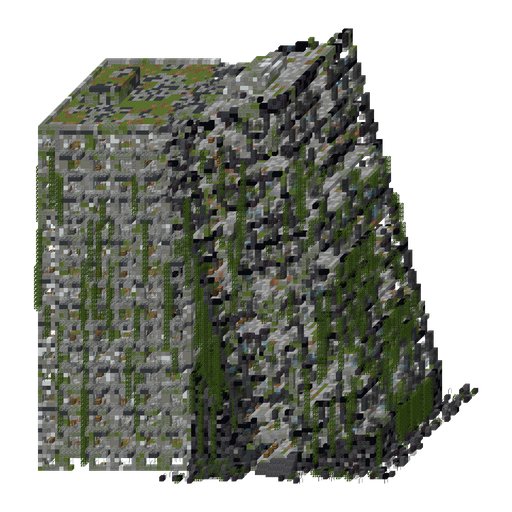

# Abandoned Modern City

Abandoned modern cities taken over by nature, linked by highways with tunnels and bridges. A NeoForge mod for
Minecraft 1.21.1.

## Features

- **Ruined cities** scattered across the overworld: streets with crosswalks and broken street lights, woods growing
  in the middle of the blocks and parks with benches and a fountain.
- **52 hand-built structures**: houses, pharmacies, car workshops, gas stations, tall office buildings, a police
  station and rare special buildings, all cracked, mossy and covered in vines.
- **Loot to find**: every chest, barrel and pot has loot that fits the place (food in houses, potions in pharmacies,
  tools in workshops...), and the hidden ones (basements, roofs, attics) are richer. The tall buildings get chests by
  their size: about one per 250 blocks of floor under a roof (±30%), at least one a floor, so a wide building has
  many more than a narrow one (~8 to 10 in a small building, ~50 in the green tower, ~70 to 108 in the wide ones).
- **Zombie spawners** in the tall buildings, near their chests, one floor in two (and in the underground garage),
  more on the wide floors than on the narrow ones (one per 500 blocks of floor under a roof, 1 to 5 a floor), and 1 to 3
  in every house, near its chests.
  They work in any light: a torch does not stop them, break them. Nothing spawns in Peaceful.
- **Highways** between the cities, with tunnels through the mountains and bridges with holes over rivers and valleys.

## Installation

1. Install **NeoForge** for Minecraft **1.21.1** (21.1.219 or newer).
2. Put `abandonedmoderncity-1.1.0.jar` in the `mods` folder.
3. Create a **new world**: the cities only appear in chunks generated with the mod.

The mod must be installed on the server (or in single player).

## Configuration

The file `config/abandonedmoderncity-common.toml` lets you change how far apart the cities are (`cellSize`), how
many cells get one (`cityChance`), switch the highways off (`highways`), generate the structures without the
vines and moss (`structureOvergrowth`) or without the zombie spawners (`zombieSpawners`), and keep the game's own
spawn (`spawnNearCity = false`; by default a new world's spawn is about 150 blocks outside the nearest city, with the
city in view). Change it before creating a world (`structureOvergrowth` and `zombieSpawners` are read when the game
starts and change only the chunks generated after; `spawnNearCity` only acts when a world is created).

## Commands

For operators: `/amcs locate city` finds the nearest city, `/amcs locate structure <category>` the nearest
structure of a kind (`house`, `pharmacy`, `gas_station`...), and `/amcs spawn <category> <name>` places a
structure in front of you.

## Known limitations

- Worlds created before installing the mod keep their old chunks: a city can be cut where old and new land meet.
- Other world generation mods have not been tested with it, except Outpost Zero: its bunkers are kept at least 48
  blocks (from the point it checks) away from the cities and highways, so they do not cut into the streets.

## License and credits

**Abandoned Modern City, created by RakkuLyc.** Free software under the GNU GPL version 3 with additional terms
(see [LICENSE](LICENSE)): you can use, share and modify it; modified versions must stay open source, credit the
original and use another name. Modpacks are welcome.

Want to build a structure for the mod? See [CONTRIBUTING.md](CONTRIBUTING.md). Changes in each version:
[CHANGELOG.md](CHANGELOG.md). For developers: [docs/DEVELOPMENT.md](docs/DEVELOPMENT.md).
